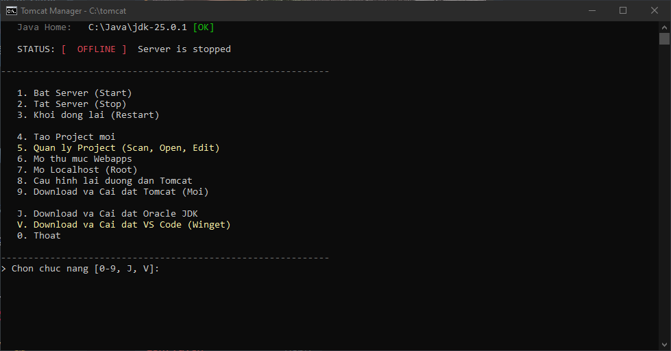

# 🚀 Apache Tomcat Manager – Fullstack Edition (v10)

**Apache Tomcat Manager CLI** (Cyber Neon) là menu dòng lệnh cho Windows giúp sinh viên làm lab Java Web: quản lý Tomcat, MySQL portable, tạo và build project Servlet/JDBC mà không cần IDE.



---

## 🛠 Yêu Cầu Hệ Thống

-   **OS**: Windows 10 (1803 trở lên) / 11
-   **Java**: JDK 11+ cho Tomcat 10.1, JDK 17+ cho Tomcat 11. Chưa có thì tải ngay trong tool (**[D] → 3**).
-   **Tomcat / MySQL / JDBC Driver**: dùng bản có sẵn hoặc tải trong tool (**[D]**).

---

## 🚀 Hướng Dẫn Sử Dụng

### 1. Khởi động
Chạy file **`TomCatMenu.cmd`**. Lần đầu tool sẽ hỏi đường dẫn Tomcat; nếu chưa có Tomcat cứ Enter bỏ qua rồi bấm **[D]** để tải.

Cấu hình được lưu vào `config.ini` nằm cạnh file script:

```ini
TOMCAT_HOME=C:\tomcat
TOMCAT_PORT=8080
MYSQL_HOME=C:\mysql
MYSQL_PORT=3306
JAVA_HOME=C:\java\jdk-21
```

`JAVA_HOME` là tùy chọn. Nếu có, tool dùng JDK đó cho Tomcat và `javac` trong phiên chạy của tool, không sửa biến môi trường của máy.

> `TOMCAT_PORT` chỉ dùng để kiểm tra trạng thái và mở trình duyệt. Muốn đổi port thật của Tomcat thì sửa `server.xml` (**[C] → 1**).

### 2. Menu Chức Năng (KeyMap)

#### Tomcat Server
-   **[1] Start / [2] Stop / [3] Restart**: tool chờ đến khi port thật sự mở/đóng rồi mới báo kết quả. Nếu Tomcat không chịu tắt, tool hỏi trước khi buộc dừng đúng tiến trình đang giữ port.
-   **[4] Logs**: theo dõi file `catalina.<ngày>.log` mới nhất.
-   **[5] User Manager**: thêm/cập nhật một user quyền `manager-gui` trong `tomcat-users.xml`. Bạn tự đặt username/password; các user khác trong file được giữ nguyên, bản cũ lưu ở `tomcat-users.xml.bak`.

#### MySQL Database
-   **[M1] Start**: tự tạo `my.ini` và khởi tạo thư mục `data` (root, không mật khẩu) nếu thiếu.
-   **[M2] Stop / [M4] Restart**: chỉ dừng MySQL đang chạy trên port đã cấu hình, không đụng tới MySQL khác (vd XAMPP).
-   **[M3] SQL Editor**: Show/Create database, quản lý bảng, chạy câu SQL tùy ý.
-   **[M5] Auto Lab 13**: tạo lại DB `lab13_jdbc` và bảng `users` (có hỏi xác nhận vì sẽ xóa DB cũ).
-   **[M6] Backup / [M7] Restore**: file `.sql` nằm trong thư mục `backups\` cạnh script, tên dạng `<db>_<yyyyMMdd_HHmmss>.sql`.

#### Project Workspace
-   **[6] New Project**: tạo project trong `webapps` từ template Servlet hoặc JDBC. Source nằm ở `WEB-INF\src` (Tomcat không public file `.java`). Template tự dùng `jakarta.servlet` (Tomcat 10+) hoặc `javax.servlet` (Tomcat 9).
-   **[7] Scan Projects**: Build (`javac` toàn bộ file `.java` trong project → `WEB-INF\classes`), mở trình duyệt, mở VS Code, xóa project (có xác nhận).
-   **[8] / [9]**: mở thư mục `webapps` / mở `http://localhost:<port>`.

#### Hệ Thống
-   **[S] Config Paths**: sửa đường dẫn/port. Enter để giữ nguyên, nhập `-` để xóa một giá trị.
-   **[C] Config Files**: mở nhanh `server.xml`, `tomcat-users.xml`, `web.xml`, `context.xml`, `my.ini`, `config.ini` (VS Code nếu có, không thì Notepad).
-   **[D] Download**:
    1.  MySQL JDBC Driver → `<Tomcat>\lib` (Maven Central)
    2.  MySQL Server portable (cdn.mysql.com)
    3.  Oracle JDK 21 / 25 (download.oracle.com)
    4.  Apache Tomcat (archive.apache.org)

---

## 📘 Kịch Bản Mẫu (Step-by-Step)

Quy trình chuẩn để làm bài Lab (VD: Lab 13 - JDBC):

**B1: Chuẩn bị môi trường**
1.  **[D]** → tải Tomcat (4), JDK (3) nếu máy chưa có.
2.  **[D]** → tải MySQL Server (2) và JDBC Driver (1).
3.  **[M1] Start MySQL**.
4.  **[M5] Auto Setup Lab13** → tạo database `lab13_jdbc` và bảng `users`.

**B2: Tạo Project**
1.  **[6] New Project** → nhập tên (VD: `Lab13`) → chọn template **2. JDBC Template**.

**B3: Code & Build**
1.  **[7] Scan Projects** → chọn `Lab13`.
2.  **[3] Edit Source** → sửa `WEB-INF\src\TestDB.java`.
3.  **[1] Build** (chờ báo *Build Success*).

**B4: Chạy thử**
1.  Về menu chính, **[3] Restart Tomcat**.
2.  **[7] Scan** → `Lab13` → **[2] Open Browser** → bấm link `/testdb`.

---

## 🔧 Troubleshooting

**Java báo MISSING trên dashboard?**
Bấm **[D] → 3** để tải JDK, hoặc **[S]** rồi nhập `Java Home` trỏ tới JDK đã cài.

**Build lỗi `package jakarta.servlet does not exist`?**
Project được tạo cho Tomcat 10+ nhưng đang build với Tomcat 9 (hoặc ngược lại với `javax.servlet`). Đổi dòng `import` cho khớp phiên bản Tomcat.

**JDBC báo `ClassNotFoundException: com.mysql.cj.jdbc.Driver`?**
Chưa có driver: **[D] → 1**, sau đó Restart Tomcat.

**Sửa script xong thì menu nhảy lung tung?**
File `.cmd` phải lưu với line ending **CRLF**. Repo đã có `.gitattributes` ép CRLF; nếu sửa bằng editor thì đừng đổi sang LF.

---

## 📂 Các File Trong Repo

| File | Ghi chú |
| --- | --- |
| `TomCatMenu.cmd` | **Bản hiện tại (v10)** – dùng file này. |
| `TomCatMenuV7.cmd`, `TomCatMenuV6.cmd`, `TomCatMenuV5.bat`, `data.json` | Các bản cũ, giữ lại để tham khảo. |

### Thay đổi chính ở v10 so với V7
-   Sửa **Restart Tomcat / Restart MySQL** (bản cũ chỉ stop rồi quay về menu, không start lại).
-   Sửa tool **tự thoát khi mở VS Code** và `config.ini` bị ghi nhầm vào `tomcat\bin` sau khi Start.
-   Sửa **Logs** (Windows không có `catalina.out`).
-   Bấm Enter không còn **lặp lại lựa chọn trước** (trước đây có thể xóa nhầm project).
-   Xóa project, drop table, restore, setup Lab13 đều **hỏi xác nhận**.
-   User Manager không còn ghi đè cả file bằng `admin/123`.
-   Build chạy được khi đường dẫn Tomcat **có khoảng trắng**.
-   Tải MySQL từ CDN chính thức (mirror cũ đã ngừng hoạt động), thêm lại mục tải Tomcat, giải nén bằng `tar` nhanh hơn nhiều so với `Expand-Archive`.
-   Kiểm tra input (tên project, database, bảng, port) trước khi dùng.

---

## 👤 Tác Giả & Phiên Bản

**Phát triển bởi**: Nguyễn Quốc Anh (NQA TECH)
**Phiên bản hiện tại**: 10.0.0 (Cyber Neon)
